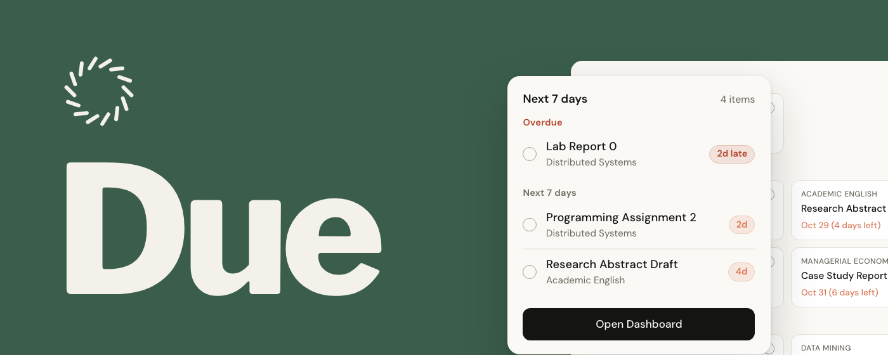
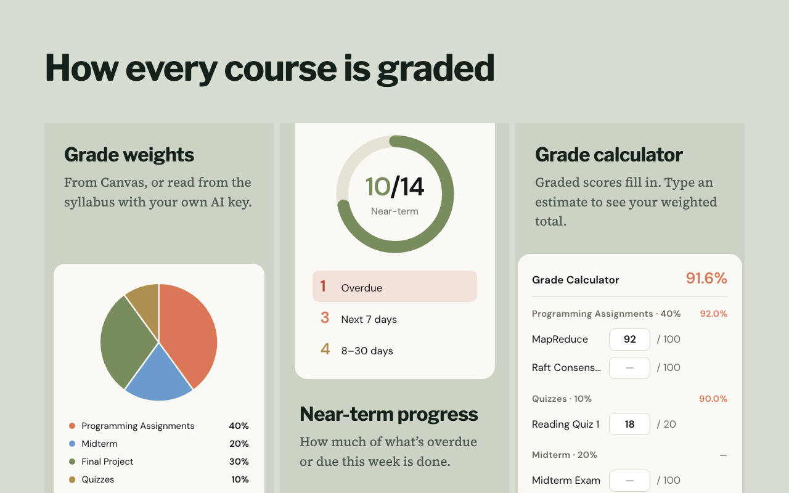
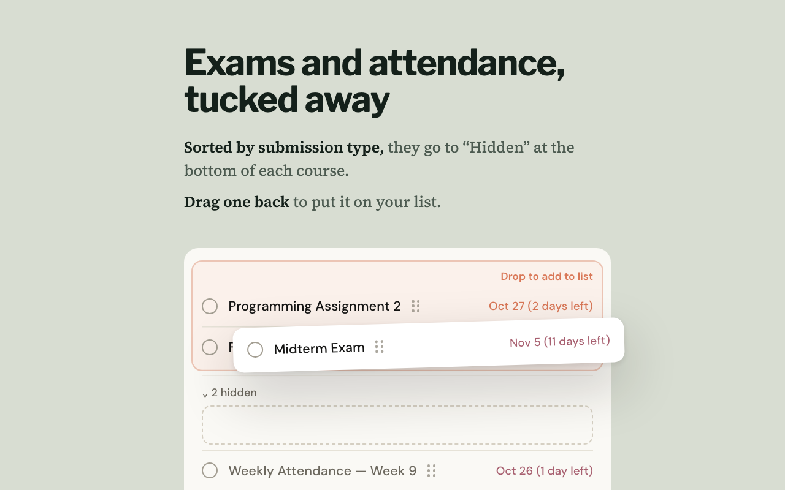

<h1>Due</h1>

<b>One page for your Canvas assignments, deadlines and grade weights</b>

  

 

<a href="README.md">繁體中文</a> · <b>English</b>

<a href="#features">Features</a> · <a href="#install">Install</a> · <a href="#privacy">Privacy</a> · <a href="#faq">FAQ</a>

 

## Why Due

Canvas has everything, but to find out what to do next you have to click into one course after another. Due puts every course's assignments, deadlines and grade weights on one page and pins anything overdue to the top. Click the toolbar icon to see what's due in the next 7 days, then open the full page in one click.

## Features

| | |
| --- | --- |
| **7-day list** | Click the toolbar icon to see what's due in the next 7 days, overdue first. Tick things off as you go, with 1.5 seconds to undo |
| **Urgency colors** | Each item is colored by how soon it's due (overdue, within 7 days, 8–30 days, 30+ days), so priorities stand out at a glance |
| **Grade weights** | Each course's weights as a pie chart. Due uses Canvas's weights when they're set, or you can enter your own |
| **Grade calculator** | Graded scores fill in automatically; add estimates to see your weighted total. Grades in the sidebar shows your grade in every course at once |
| **Exams and attendance, tucked away** | Based on the assignment type and name, they go into "Hidden" at the bottom of each course; anything you need to hand in stays on your list. If Due gets one wrong, drag it back |
| **Custom assignments and course names** | Add assignments that Canvas doesn't know about, and rename any course whose name is too long |
| **AI grade weights (optional)** | For courses without weights in Canvas, add your own Gemini, Qwen, DeepSeek or NVIDIA NIM key and Due reads the syllabus to fill them in |
| **Three languages** | English, 繁體中文 and 简体中文 |

  
  

## Install

Install it from the [Chrome Web Store](https://chromewebstore.google.com/detail/due/mgncgfpppjecmfkahchchidfpckpnfid?hl=en), then open your school's Canvas in the same browser and sign in. Due syncs automatically, and again each time you open Canvas; you can also press Sync in the dashboard. No API token, no sign-up.

It works with schools whose Canvas address ends in .instructure.com (for example hkust-gz.instructure.com). Schools that host Canvas on their own domain aren't supported yet.

## Privacy

Due has no server and no tracking. Your data stays in your browser and never reaches the developer. If you turn on the optional AI analysis, the syllabus and course PDFs of courses without grade weights (and, when needed, the list of course PDF file names) go straight from your browser to the AI provider you picked, using your own key. If you use claude.ai, the popup can also show your Claude usage; that's why Due asks for access to claude.ai, and those figures stay in your browser too. See the [privacy policy](privacy-policy.md).

## FAQ

Is it free?

 
Yes, free and open source. AI analysis uses your own key's quota.

Does it work on my phone?

 
No. Due is an extension for desktop Chrome, though you can usually install it in other Chromium browsers such as Edge and Brave too (Edge first needs extensions from other stores to be allowed). We haven't tested each one.

## Contributing

Found a bug or have an idea? [Open an issue](https://github.com/Raytengo/Due/issues) or send a pull request. The extension's code lives in `extension/`; the quickest way to understand how it works is to hand it to Claude.

## License

[MIT](LICENSE)
