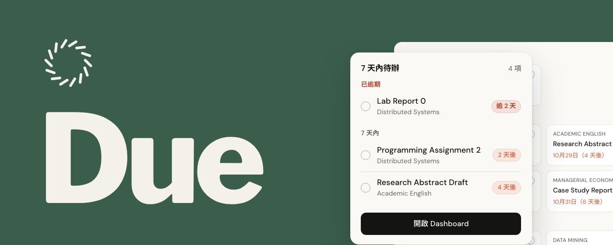
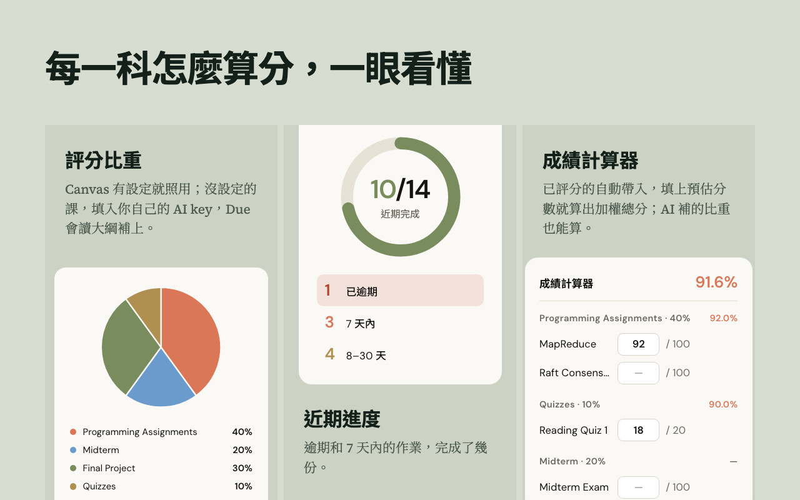
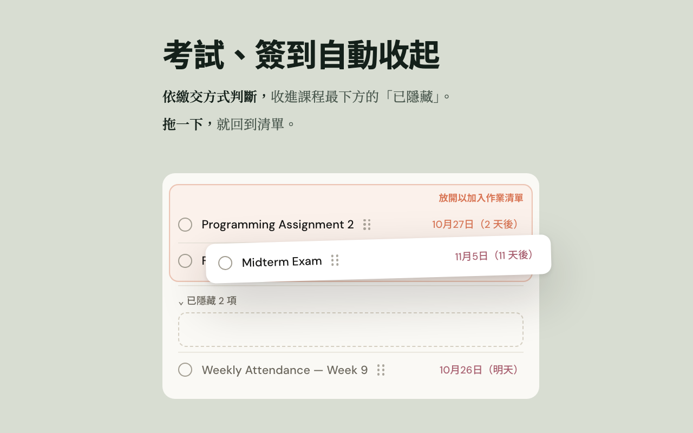

<h1>Due</h1>

<b>Canvas 作業、截止日與評分比重的一頁儀表板</b>

  

 

<b>繁體中文</b> · <a href="README.en.md">English</a>

<a href="#功能">功能</a> · <a href="#安裝">安裝</a> · <a href="#隱私">隱私</a> · <a href="#常見問題">常見問題</a>

 

## 為什麼做 Due

Canvas 很完整，但要知道「接下來該做什麼」，得一門課一門課點進去找。Due 把每一門課的作業、截止日和評分比重整理成一頁，逾期的釘在最上面；點一下工具列先看 7 天內要交的，再一鍵打開完整頁面。

## 功能

| | |
| --- | --- |
| **7 天待辦** | 點工具列就看到 7 天內要交的，逾期的置頂，做完直接勾掉（1.5 秒內可以反悔） |
| **緊急度上色** | 逾期、7 天內、8–30 天、30 天以上，一眼分得出輕重 |
| **評分比重** | 每門課的比重畫成圓餅圖；Canvas 有設定就照用，也可以自己填 |
| **成績計算器** | 已評分的自動帶入，填上預估分數就算出加權總分；側欄「成績」一次看每一科 |
| **自動收起考試與簽到** | 依作業類型和名稱判斷，收進每門課最下方的「已隱藏」；要交東西的作業不會被收起，判斷錯了拖回清單就好 |
| **自訂作業、課程改名** | Canvas 上沒有的待辦也能加；課名太長就改個好認的 |
| **AI 補比重（選用）** | Canvas 沒設比重的課，填入你自己的 Gemini、Qwen、DeepSeek 或 NVIDIA NIM 金鑰，Due 讀大綱補上 |
| **三種語言** | 繁體中文、简体中文、English |

  
  

## 安裝

到 [Chrome 線上應用程式商店](https://chromewebstore.google.com/detail/due/mgncgfpppjecmfkahchchidfpckpnfid?hl=zh-TW)安裝，然後在同一個瀏覽器打開學校的 Canvas 並登入，Due 就會自動同步；之後每次打開 Canvas 都會順便更新，也可以在 Dashboard 按「同步」。不用 API token，也不用註冊。

Canvas 網址結尾是 instructure.com 的學校都能用（例如 hkust-gz.instructure.com）；用自己網域架設的 Canvas 目前還不支援。

## 隱私

Due 沒有伺服器、沒有追蹤。資料只存在你的瀏覽器，開發者收不到。開啟選用的 AI 分析時，還沒有比重的課，其大綱與課程 PDF（必要時還有課程 PDF 的檔名清單）會用你自己的金鑰，從你的瀏覽器直接送到你選的 AI 供應商。如果你有用 claude.ai，popup 也能顯示 Claude 的用量，所以 Due 會要求 claude.ai 的權限；這些數字同樣只存在你的瀏覽器。完整內容見[隱私權政策](privacy-policy.md)。

## 常見問題

要錢嗎？

 
不用，免費、開源。AI 分析用的是你自己金鑰的額度。

手機能用嗎？

 
不行，Due 是電腦版 Chrome 的擴充功能。Edge、Brave 這類 Chromium 瀏覽器通常也能從 Chrome 商店安裝（Edge 要先允許其他市集的擴充功能），但沒有逐一實測。

## 參與

有 bug 或想法，歡迎[開 issue](https://github.com/Raytengo/Due/issues) 或送 PR。擴充功能的程式碼都在 `extension/`；想知道它怎麼運作，丟給 Claude 讀最快。

## 授權

[MIT](LICENSE)
