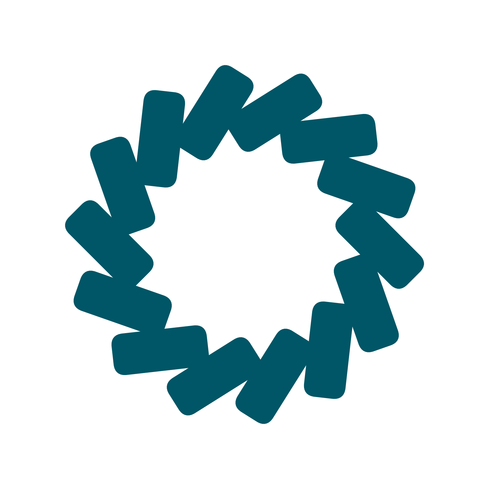

<div align="center">



# Due

**一眼看懂：現在該做哪份作業。**

Due 是一個 Chrome 擴充功能，能同步任何 Canvas LMS，把所有作業、截止日期與
評分比重整理進一個乾淨、依緊急度排序的 Dashboard——不需要 Canvas API token、
不用註冊帳號、沒有伺服器。另有選用的 AI 功能可從課程大綱抓出評分比重，想用
的話自備 LLM API key 即可。

🌐 [English](README.md) · **繁體中文**

</div>

---

## 它能做什麼

Canvas 把真正重要的事埋在一層層選單與分頁底下。Due 把它收斂成一個問題：
*我接下來該做什麼？*

- 點工具列圖示，打開 **7 天待辦 popup**——本週所有到期作業，加上置頂的「已逾期」清單，一眼掃完。
- 打開 **Dashboard** 看完整全貌——每一門課、每一份作業，依緊急度標色，附評分比重與即時成績計算器。

Due 以「你」的身分登入：它借用瀏覽器裡現成的 Canvas 登入狀態，所以完全不用
設定。登入 Canvas 一次，之後就會自動同步。

---

## 功能

| | |
|---|---|
| **7 天待辦 popup** | 本週到期作業一覽，含置頂「已逾期」區 |
| **緊急度色階** | 逾期紅 · ≤7 天橘 · 8–30 天黃 · 30 天以上藍 |
| **本週進度環** | 本週作業完成了多少，並依緊急度分級呈現 |
| **評分比重** | 每門課的作業分組與各自權重 |
| **成績計算器** | 輸入分數即時算加權總分——Canvas 已評分自動預填 |
| **拖曳整理** | 考試與簽到自動隱藏；可把任何隱藏項拖回，或把其他項收起 |
| **一鍵完成** | 任何項目都可標記完成（附 1.5 秒撤銷窗口），獨立於 Canvas 繳交狀態 |
| **自訂作業** | 加入 Canvas 沒有、但你自己要追蹤的待辦 |
| **課程重新命名** | 給任何課程一個好記的顯示名稱——只存在本機 |
| **新手教學** | 首次開啟有 5 頁導覽帶你完成設定 |
| **Claude 用量** | 選用：在 popup 顯示你的 Claude 方案用量 % |
| **多語言** | 繁體中文 · 简体中文 · English |

---

## 適用任何 Canvas 學校

Due 從不要求 Canvas API token 或密碼。它使用瀏覽器裡既有的 Canvas 登入狀態，所以任何
使用 Canvas 的學校都能直接用——只要你已經登入。Due 唯一會問你要的 key 是選用
的：開啟 AI 評分比重分析時，你自己的 Gemini／Qwen／DeepSeek API key（見下方）。

---

## 安裝

Due 已上架 Chrome Web Store，一鍵安裝、免設定：

**[→ 加到 Chrome](https://chromewebstore.google.com/detail/due/mgncgfpppjecmfkahchchidfpckpnfid?hl=zh-TW)**

接著**登入 Canvas**，下次造訪時 Due 就會自動同步。點 Due 圖示 →「**開啟 Dashboard**」，並 📌 建議把擴充功能釘選，方便一鍵開啟。首次開啟時會有一段 5 頁導覽帶你走一遍。

---

## 選用：AI 評分比重分析

有些課程從不在 Canvas 上填權重。開啟這個功能後，Due 會在每次同步後讀課程大綱
（文字與 PDF），抓出評分比重，寫進該課的**手動權重**——和你自己手動輸入是
同一個地方，所以隨時可以改、可以還原。

- 設定齒輪 →「**AI 分析設定**」→ 選 Gemini／Qwen／DeepSeek，貼上你自己的
  API key，儲存。
- 每門課只分析**一次**；已有 Canvas 或手動權重的課會跳過。沒填 key 什麼都不會跑。
- Chrome 會問一次是否允許存取 `canvas-user-content.com`，用來下載大綱 PDF；
  拒絕也能用，只是只讀大綱文字。
- 大綱內容直接從你的瀏覽器送到你選的供應商，中間沒有 Due 的伺服器。

---

## 隱私

所有資料都留在你的裝置上。Due **沒有後端伺服器、沒有分析追蹤、也沒有任何
遙測**——資料全存在 `chrome.storage.local`，絕不會傳送給開發者。若你開啟選用
的 AI 分析，課程大綱會用你自己的 key 直接送到你選的供應商，開發者不經手。
完整說明見[隱私政策](privacy-policy.md)。

---

## 給開發者

Due 是純 **vanilla JavaScript** 搭 **Manifest V3**——無框架、無建置步驟。

```
extension/
├── manifest.json      # MV3 設定
├── background.js      # service worker：Canvas API 同步 + Claude 用量
├── ai/*.js            # 選用的 AI 評分比重分析：gradingRules · providers · analysisRunner
├── popup.html / .js   # 工具列 popup（7 天待辦）
└── dashboard/
    ├── index.html     # Dashboard 骨架 + 樣式
    ├── dashboard.js   # 渲染 + 事件
    ├── aiSettings.js  # AI 分析設定 modal
    └── *.js           # taskRules · completion · customAssignments · descSanitizer
```

- **載入：** 修改 `extension/` 下任何檔案後，到 `chrome://extensions` 重新載入。
- **快速迭代：** 執行 `node dev/serve.js`，打開 <http://localhost:8765/dev/harness.html>
  （或 `popup-harness.html`），就能在一般分頁用 mock 資料開發 Dashboard 與 popup。
- **測試：** 共用邏輯模組都有純 Node 單元測試，例如
  `node extension/dashboard/taskRules.test.js`。
- **AI 模組測試：** `node extension/ai/gradingRules.test.js`、`node extension/ai/providers.test.js`。

完整架構、資料格式與設計規範，見 [`CLAUDE.md`](CLAUDE.md)。

---

<div align="center">
<sub>版本 2.1.0 · <a href="LICENSE">MIT License</a></sub>
</div>
