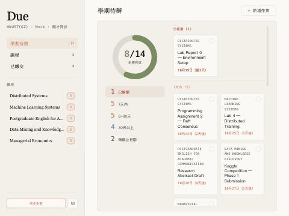
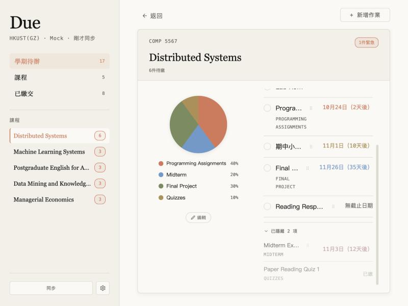
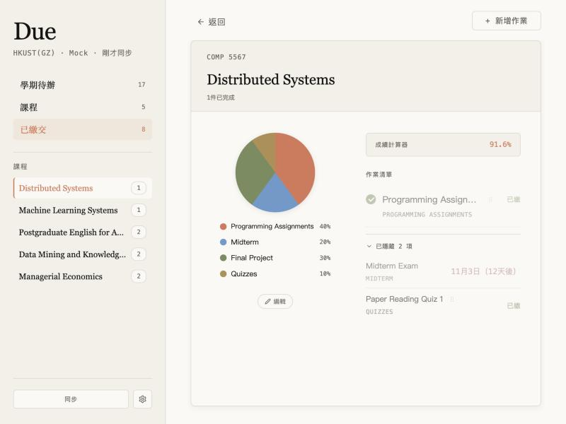

# Due QA 報告（2026-10-22）

> **方法**：11 個 lens 平行稽核（2 個「新使用者」persona 實際操作 harness ＋ 9 個測試 lens：錯誤處理、拖曳/完成狀態矩陣、日期與成績、狀態與併發、a11y/i18n/RWD、安全/隱私/上架合規、使用者自建資料 CRUD、時間與換學期、spec 一致性與動畫）。每個 lens 由**另一個 agent 反證驗證**（嘗試推翻、自己重現）。206 條原始 findings → 去重後 **5 P0 / 11 P1 / 16 P2 / 約 35 P3**。P0/P1 我另外讀碼複核，朋友回報的 A、B 在 harness 親手重現並截圖（`docs/qa/img/`）。
>
> **限制**：沒有接真的 Canvas、沒有以「已安裝的擴充功能」執行（harness 只 stub `chrome.*`）。Service worker 時序類問題標「推定」。

---

## 一頁摘要

| P0 | P1 | P2 | P3 |
|---|---|---|---|
| 5 | 11 | 16 | ~35 |

1. **同步會悄悄刪資料**：只要某一門課的請求失敗（Canvas 限流 403、5xx、網路抖一下），那門課的作業就被寫成空陣列，畫面還顯示「剛才同步」。學生會以為那門課沒作業。→ P0-1
2. **關鍵字把真作業當考試/簽到永久藏起來**：`Design Inspiration Board`（含 "sign in"）、`Checking Algorithm HW`（含 "checkin"）、`Midterm Project Report`、`Unit Test 3 Report` 全部被藏。考試類一過截止還**自動算完成**，連逾期區都不會出現。→ P0-2
3. **朋友回報 A 是真的，而且錯誤在四層被丟掉**：background 有帶錯誤字串，dashboard 不讀；字串本身在 HTTP/2 下只剩 `Canvas API error: 401 `；自動同步失敗只寫 console；popup 完全不顯示同步狀態。→ P0-3、P0-4
4. **朋友回報 B 不是程式壞掉，是規則看不見**：已隱藏區某列能不能拖＝「它的完成狀態是否和『已繳交』開關一致」，畫面沒有任何說明。需要你拍板。→ P1-1
5. **商店頁寫「任何 Canvas 學校」，實際只支援 `*.instructure.com`**，onboarding 的「登入 Canvas」還寫死開 HKUST(GZ)。→ P0-5

**最小下一步**：修 P0-1（同步失敗時保留該課舊資料＋回報部分失敗），約 20 行，風險最低、傷害最大。

---

## 朋友回報的兩個問題：根因

### (A)「API 回了錯誤代碼，但被系統截掉，也不知道代碼是什麼意思」

在 harness 讓 background 回 `{success:false, error:'Canvas API error: 401 Unauthorized'}`，按鈕只顯示「同步失敗」，沒有 title、沒有 aria、2.5 秒後變回「同步」；側欄仍寫「剛才同步」。錯誤在以下四層被丟掉：

| 層 | 位置 | 問題 |
|---|---|---|
| 1. 產生 | `extension/background.js:208`、`:120` | `Canvas API error: ${status} ${statusText}`——HTTP/2 下 `statusText` 是空字串，只剩 `Canvas API error: 401 `；Canvas 回的 JSON error body 從不讀；未登入時 Canvas 可能回 200 + HTML 登入頁 → `res.json()` 拋 `SyntaxError: Unexpected token <`，使用者看到的是 JSON 解析錯誤 |
| 2. 傳遞 | `extension/background.js:286` | 「尚未偵測到 Canvas 網址…」寫死繁中，英文/簡中使用者也收到這句 |
| 3. 顯示 | `extension/dashboard/dashboard.js:2874-2883` | `resp.error` 完全沒用到；2.5 秒後恢復，沒有原因、沒有下一步（登入？重試？） |
| 4. 自動同步 | `extension/background.js:50-52` | 造訪 Canvas 時的自動同步是**主要同步路徑**，失敗只有 `console.error`，沒寫進 storage；dashboard 和 popup 永遠不知道最近一直在失敗 |
| 5. Popup | `extension/popup.js:453-461` | 不讀 `lastSync`、沒有錯誤狀態：從沒同步過、同步一直失敗、資料過期三週，一律顯示「七天內沒有待繳作業」 |

另外兩個時序 bug 會**製造**同步失敗（P0-4）：SW 閒置被終止後，第一次按同步時 `BASE_URL` 可能還沒從 storage 讀回 → 回「尚未偵測到 Canvas 網址」（推定，很可能就是朋友遇到的）；自動同步進行中再按「同步」會立刻回 `success:true`，畫面重載舊資料（node 模擬重現）。

**修法**（P0-3）：background 把錯誤分類成代碼並寫進 storage `lastSyncError: {code, status, at, failedCourses}`，成功時清除；dashboard 在主區頂端放**持續存在**的錯誤橫幅（不是按鈕上閃 2.5 秒），popup 在標題下加一行「上次同步 3 小時前 · 需要重新登入 Canvas」。

| 代碼 | 偵測條件 | 顯示給使用者（zh-TW） | 動作 |
|---|---|---|---|
| `NO_BASE_URL` | BASE_URL 空 | 還不知道你的 Canvas 網址 | 「開啟 Canvas」 |
| `NOT_LOGGED_IN` | 401，或回應不是 JSON（被導到登入頁） | Canvas 登入已過期 | 「前往登入」 |
| `RATE_LIMITED` | 403 且 body/標頭含 Rate Limit | Canvas 暫時限制請求，稍後自動重試 | 自動 backoff |
| `FORBIDDEN` | 其他 403 | 部分課程無法讀取（可能已關閉） | 列出課名 |
| `SERVER` | 5xx | Canvas 伺服器暫時異常 | 「重試」 |
| `OFFLINE` | `TypeError: Failed to fetch` | 網路連不上 | 「重試」 |
| `PARTIAL` | 部分課程失敗 | N 門課沒更新，顯示的是上次資料 | 列出課名 |

橫幅下方以小字保留原始代碼（例：`錯誤代碼 401 · 10:42`）加「複製詳細資訊」，方便朋友回報。三語 i18n。

### (B)「拖曳隱藏/顯示，會因為有沒有點『已繳交』而不同，搞不清楚」

| 未完成視圖 | 已繳交視圖 |
|---|---|
|  |  |

COMP 5567 已隱藏區：`Midterm Exam`（還沒考）在未完成視圖有握把、`Paper Reading Quiz 1`（已繳）淡化無握把；切到「已繳交」**兩者對調**。

**機制**：`extension/dashboard/dashboard.js:2497` `draggable = isDone(a) === showSubmitted`。作業清單由 `applyFilters`（`:784-796`）依完成狀態過濾，但已隱藏區**不過濾**、列出全部。若允許把「已完成」項拖進「未完成」清單，它會因過濾立刻消失——7/22 的 same-bucket spec 為了避免「憑空消失」選擇把它鎖住。

**為什麼新使用者看不懂**：
1. 鎖不鎖取決於**側欄**的一個過濾開關，而課程詳情頁內看不出目前有沒有開「已繳交」。
2. 可拖 vs 鎖住的差別只有透明度 0.55 vs 0.4，加一個 13px、對比 1.4:1 的握把；沒有 tooltip、沒有文字。
3. 已隱藏列**不顯示完成狀態**（沒有勾選圈），使用者無從推出規則。
4. 時間差：考試時間一過，原本可拖的列換到另一個桶；render 當下算的可拖性過期，拖上去兩邊都看不到（`#178`）。
5. 在「已繳交」視圖把項目拖出來，切回預設視圖它就從課程頁消失。
6. 只能用滑鼠拖 13px 握把，握把 `aria-hidden`、不可聚焦，鍵盤完全不能操作。

**哪部分是刻意設計**：same-bucket 規則本身（spec `2026-07-22-same-bucket-exam-drag-design.md`）。真正的衝突是「清單依完成狀態過濾、已隱藏區不過濾」；只要這兩者不一致，就一定會有鎖住的列。

**我的提案**（需要你拍板，見文末決策 1）：**讓已隱藏區跟清單套同一個過濾**——未完成視圖只列未完成的隱藏項、已繳交視圖只列已完成的；標題寫「已隱藏 1 項（另 1 項已完成，在『已繳交』中）」。結果是**畫面上看得到的列一律可拖**，鎖住狀態整個消失，規則變成一句話：「看得到就能移」。同時每列加一個可鍵盤操作的「顯示/隱藏」按鈕（眼睛 icon）＋ 落點後 3 秒的「已移回清單 · 復原」提示。代價：放棄 spec 中「兩個視圖都列出完整稽核清單、數量穩定」這一點——但那正是鎖住狀態的來源。

---

## 新使用者視角：前 5 個困惑點

1. **第一次同步就失敗，只閃「同步失敗」2.5 秒**：不知道是沒登入、要先開 Canvas、還是擴充壞了。空狀態的兩句指示互相矛盾，也沒有 Canvas 連結。（P0-3、P2-6）
2. **Popup 說「七天內沒有待繳作業」**，其實是從來沒同步成功。新使用者會以為真的沒作業。（P0-3）
3. **已隱藏區有些列能拖、有些不能**，而且會隨「已繳交」翻轉。（P1-1）
4. **時間標籤沒有幾點**：明天 09:00 截止與 23:59 截止看起來一樣；不到 30 分鐘顯示「0h後」，像已經到期；今晚 00:10 截止在 23:40 時顯示「1天後」。（P1-5）
5. **自己新增「Quiz 1 準備」，按存檔就不見了**——被當成考試自動隱藏。（P1-6）

附帶：1024px 寬的筆電半螢幕下，課程詳情的作業名被擠成「Progra…」「期中小…」（截圖 B1 可見，P1-10）。

---

## 總表

驗證欄：✅ 重現（node 或 harness 實際跑出）／🔍 讀碼確認／❓ 推定（邏輯成立但沒在真實 Chrome 驗證）

| ID | P | 類型 | 標題 | 主要位置 | 工作量 | 驗證 |
|---|---|---|---|---|---|---|
| P0-1 | P0 | bug | 單課同步失敗會清空該課作業，仍回報成功 | `background.js:307-330` | S | ✅ |
| P0-2 | P0 | bug | 考試/簽到關鍵字誤判，真作業被永久隱藏、過期還自動算完成 | `taskRules.js:18-53` | S | ✅ |
| P0-3 | P0 | bug/ux | 同步錯誤在四層被丟掉（朋友回報 A） | `dashboard.js:2874`、`background.js:50,208,286`、`popup.js:453` | M | ✅ |
| P0-4 | P0 | bug | 同步時序：SW 冷啟動 BASE_URL 未就緒；重入時回假成功 | `background.js:1-18,77-83,280-287` | S | ❓／✅ |
| P0-5 | P0 | compliance | 「任何 Canvas 學校」不實；onboarding 寫死 HKUST(GZ) | `manifest.json:12-15`、`dashboard.js:3130`、README、store-listing | S（文案）／M（權限） | 🔍✅ |
| P1-1 | P1 | design-debt | 已隱藏區可拖性綁在「已繳交」開關（朋友回報 B） | `dashboard.js:2497` | M | ✅ |
| P1-2 | P1 | bug | 完成標記 lost update：dashboard 用舊快照覆寫 popup/其他分頁的變更 | `dashboard.js:664-682,729-751` | S | ✅ |
| P1-3 | P1 | bug | 開著的 dashboard 不隨同步、popup、時間更新（到期了仍橘色「15h後」） | `dashboard.js:3113-3121`；全檔無 timer | M | ✅ |
| P1-4 | P1 | bug | 完成狀態卡死：先手動勾、後 Canvas 已繳 → 再也標不回未完成 | `completion.js:44-47`、`dashboard.js:664`、`popup.js:329` | S | ✅ |
| P1-5 | P1 | ux | 時間標籤不顯示幾點；臨界值誤導（0h後／1天後／今天到期） | `dashboard.js:550-581`、`popup.js:90-136` | S | ✅ |
| P1-6 | P1 | bug | 自訂作業名稱含 Quiz/Midterm/簽到 → 存完立刻被隱藏 | `dashboard.js:719-721` | S | ✅ |
| P1-7 | P1 | bug | Popup 不讀自訂作業 | `popup.js:453-458`、`popup.html:452` | S | ✅ |
| P1-8 | P1 | bug | 「← 返回」每次重繪多綁一個 listener，按一次退好幾步甚至離開 dashboard | `dashboard.js:2135` | S | ✅ |
| P1-9 | P1 | bug | 造訪任何 `*.instructure.com`（status、www、交換學校）都會覆寫學校網址 | `background.js:35-71` | M | ✅ |
| P1-10 | P1 | ux | 681–1150px 寬時課程詳情作業名被擠到 0–1 字 | `index.html:2645,3382` | S | ✅ |
| P1-11 | P1 | compliance/privacy | claude.ai 用量：對所有人注入 MAIN-world fetch patch，未揭露、隱私權政策過時、權限過寬 | `manifest.json`、`claude_injected.js`、`privacy-policy.md` | M | 🔍✅ |
| P2-1 | P2 | bug | 課程卡/側欄 badge 沒套 30 天逾期窗，舊逾期佔滿卡片、計數對不上 | `dashboard.js:1563-1580,1088` | S | ✅ |
| P2-2 | P2 | bug | 成績計算器不用自訂權重（圓餅用自訂、計算器用 Canvas） | `dashboard.js:2601-2604,2695-2722` | S | ✅ |
| P2-3 | P2 | bug | 計算器改一格就把所有 Canvas 預填固化成手動值 | `dashboard.js:2727-2746` | S | ✅ |
| P2-4 | P2 | bug | 計算器忽略 drop_lowest／extra credit；總分意義未標示 | `dashboard.js:2611,2706-2722` | M | ✅ |
| P2-5 | P2 | bug | Canvas 資料語意：紙本/無需繳交/免除/鎖定項卡在逾期區；缺交 0 分當成已繳；TA/旁聽課 | `completion.js:9-30`、`background.js:222` | M | ✅❓ |
| P2-6 | P2 | ux | 空狀態沒出路；學期空檔時「請先登入並同步」是錯的 | `dashboard.js:2897-2913`、`background.js:302` | S | ✅ |
| P2-7 | P2 | perf | 作業描述存兩份、無 unlimitedStorage、`set` 失敗被吞 → 重度使用者可能撞 10MB | `background.js:232-236,324` | S | ❓ |
| P2-8 | P2 | ux | Popup 清單只看得到 2.5 筆、無總數；長課名把列撐高 | `popup.html:168-173,309-315` | S | ✅ |
| P2-9 | P2 | ux | Modal 內拖曳選字、放開在背景上會關閉並丟失輸入 | `dashboard.js:2813,3312` | S | ✅ |
| P2-10 | P2 | bug | OS 時區與課程時區不同時，日期差一天 | `dashboard.js:550-581` | M | ✅ |
| P2-11 | P2 | a11y | 對比不足：截止色 2.8–3:1、勾選圈邊框 1.32:1、focus 外框 <3:1 | `index.html:987,1216-1226` | S | ✅ |
| P2-12 | P2 | a11y | 鍵盤不可及：作業連結/描述展開/計算器是 div/span；語言子選單、鉛筆鈕只有 hover | 多處 | M | ✅ |
| P2-13 | P2 | bug | Onboarding：Tab 聚焦到畫面外投影片導致錯頁；`?welcome=1` 重新整理又開教學 | `index.html:1448`、`dashboard.js:3142` | S | ✅ |
| P2-14 | P2 | i18n | 重命名按 Enter 不排除 IME 組字，注音/拼音選字就提交 | `dashboard.js:1865,1930` | S | 🔍 |
| P2-15 | P2 | ux | 週待辦 768–900px 卡片被裁切、出現水平捲動 | `index.html:635-640,872` | S | ✅ |
| P2-16 | P2 | design-debt | 舊學期課程仍 active 時永久佔據側欄/計數；無法封存整門課 | `background.js:203-205` | M | ❓ |

---

## 詳細清單

### P0 — 再推廣給更多人之前先修

#### P0-1 單課同步失敗會清空該課作業，仍回報成功
- **症狀**：某門課的 `assignments` 或 `assignment_groups` 任一請求失敗（403 限流、5xx、斷線），那門課在所有視圖變成「無待辦事項」，側欄寫「剛才同步」。
- **重現**：node vm 載入 `background.js`，stub fetch 讓課程 102 的 assignment_groups 回 403 → `SYNC resp: {"success":true}`、`stored assignments[102]: []`、`lastSync age: 0s`。
- **根因**：`extension/background.js:316-319` catch 內寫 `assignments[course.id] = []`，接著 `:324` 整包 `storage.set`，覆蓋上次成功的資料。`:307-322` 同時對每門課發 2 個請求、沒有併發上限，修 6–8 門課就是 12–16 個並行請求，可能觸發 Canvas 限流，反過來觸發這個 bug（推定）。
- **修法**：同步前讀出舊的 `assignments`/`assignmentGroups`；單課失敗時**沿用舊值**並記入 `failedCourses`；回傳 `{success:true, partial:true, failedCourses}` 交給 P0-3 顯示。併發限制在 4，403 帶 Rate Limit 時指數退避重試一次。
- **來源**：error-handling、dates-grades、state、security、persona ×2（6 個 lens 獨立發現）。

#### P0-2 考試/簽到關鍵字誤判，真作業被永久隱藏、過期還自動算完成
- **症狀**：以下名稱實測（node 跑真實 `taskRules.js`）：

  | 名稱 | isExam | isAttendance | 原因 |
  |---|---|---|---|
  | Design Inspiration Board | – | **true** | "de**sign in**spiration" 含 `sign in` |
  | Checking Algorithm HW | – | **true** | "**checkin**g" 含 `checkin` |
  | Weekly Check-in Report | – | **true** | 交報告的作業 |
  | Participation Reflection | – | **true** | 交心得的作業 |
  | Midterm Project Report | **true** | – | `\bmidterm\b` |
  | Final Exam Review Worksheet | **true** | – | `\bexam\b` |
  | Unit Test 3 Report | **true** | – | `test\s*\d` |

- **為什麼是 P0**：被判成考試的項目，截止一過 `isExamConcluded`（`taskRules.js:47-53`）就算外部完成——**不會進逾期區**，只在課程頁底部收合的已隱藏區裡。學生可能完全看不到一份要交的報告。
- **修法**：①簽到關鍵字改字邊界 regex（`/\b(sign[\s-]?in|check[\s-]?in)\b/i`）；②加「交付物否決詞」：名稱含 report / reflection / project / proposal / worksheet / essay / plan / presentation / draft / 作業 / 報告 / 專題 / 心得 → 不判考試也不判簽到；③`isExamConcluded` 只在 `submission_types` 沒有 `online_upload`/`online_text_entry` 時成立（要上傳的東西不會「考完」）；④上表全部加進 `taskRules.test.js` 當回歸測試；⑤週待辦底部加一行「已自動隱藏 N 項 · 檢查」，讓誤判看得到。
- **來源**：persona-dashboard、persona-popup、dates-grades（我另外用 node 重跑確認）。

#### P0-3 同步錯誤在四層被丟掉（朋友回報 A）
見上方〈朋友回報的兩個問題〉(A)。修法含錯誤代碼表、持續橫幅、popup 狀態列、`lastSyncError` 持久化、三語 i18n。
- **附帶**：同步失敗按鈕的紅色與 hover 同色（`index.html:339-342`）；同步中按鈕只有三個點，沒有可讀名稱；沒有 live region。

#### P0-4 同步時序：SW 冷啟動 BASE_URL 未就緒；重入時回假成功
- **(a) 冷啟動**（❓推定）：`background.js:11-18` 用 callback 版 `storage.local.get` 在頂層非同步回填 `BASE_URL`/`_lastAutoSyncAt`，但 `onMessage`（`:77-83`）與 `webNavigation`（`:35-71`）handler 不等它。MV3 SW 閒置約 30 秒會被終止，下一個事件喚醒時 handler 很可能先跑 → 手動同步回「尚未偵測到 Canvas 網址」；導航事件則因 `origin !== ''` 誤判 `baseUrlChanged`，繞過 5 分鐘節流做全量同步。這很可能是朋友遇到的「同步失敗」來源之一。
- **(b) 重入**（✅ node 重現）：`syncAll` 在 `_syncing` 時 `return undefined`（`:280-283`），handler `.then` 一律回 `success:true`（`:79-81`）。首次安裝時自動同步正在跑，使用者按「同步」→ 立刻「成功」→ 重載到空資料 → 又看到「尚無資料」；進行中那次若 401，使用者完全不知道。
- **修法**：`const ready = new Promise(r => chrome.storage.local.get([...], d => {...; r();}))`，所有 handler 先 `await ready`；`syncAll` 改為保存 `_syncPromise`，重入時回傳同一個 promise。兩者合計約 15 行。

#### P0-5 「任何 Canvas 學校」不實；onboarding 寫死 HKUST(GZ)
- **事實**：`manifest.json:12-15` host_permissions 只有 `https://*.instructure.com/*`，`background.js:69` 也只監聽 `.instructure.com`。用自訂網域的學校（canvas.ust.hk、canvas.ubc.ca、bcourses.berkeley.edu…）**完全無法同步**，畫面也不會說原因。但 `README.md:9,51`、`docs/store-listing.md:73` 寫「Works with any Canvas school」。
- **Onboarding**：`dashboard.js:3130` 在沒有課程時一律開 `https://hkust-gz.instructure.com`，即使已偵測到別的學校；這次造訪又會把 `canvasBaseUrl` 改成 hkust-gz（連帶 P1-9）。
- **修法**：現在（S）——商店頁/README 改成「支援網址為 `*.instructure.com` 的 Canvas 學校」；onboarding 沒有已知網址時改成「打開你學校的 Canvas」說明，不給寫死連結。之後若真有需求（M）——`optional_host_permissions: ["https://*/*"]` ＋ 使用者輸入學校網址後 `permissions.request` ＋ `scripting.registerContentScripts`。

### P1 — 核心流程困惑、朋友回報、無法恢復的錯誤

#### P1-1 已隱藏區可拖性綁在「已繳交」開關（朋友回報 B）
見上方 (B)。提案見決策 1。

#### P1-2 完成標記 lost update
- **重現**：harness 開 dashboard，在另一處（模擬 popup）寫入 `manualDone.A=true`，再在 dashboard 勾 B → storage 只剩 B，A 回到待辦。兩個 dashboard 分頁互勾同理。
- **根因**：`toggleCompletion`／`revertCompletion`／`setManualShown`／`setManualHidden`（`dashboard.js:664-682,729-751`）都以 `_currentData` 快照整包寫回；dashboard 唯一的 `storage.onChanged`（`:3113-3121`）只在 onboarding 期間看 `lastSync`。
- **修法**：寫入改為 read-modify-write（先 `get([key])` 再改再 `set`），並加常駐 `storage.onChanged` 同步 `_currentData` 的 manual* map（P1-3 一併處理）。

#### P1-3 開著的 dashboard 不隨同步、popup、時間更新
- **症狀**：背景自動同步完成、popup 勾完成後，開著的 dashboard 都不變，header「N 分鐘前」凍結；截止已過的作業仍顯示橘色「15h後」，考試結束、7/30 天邊界、30 天逾期窗都不重算（`dashboard.js` 全檔 0 個 `setInterval`/`visibilitychange`，已 grep 確認）。
- **修法**：常駐 `storage.onChanged` → debounce 300ms `loadData()`（拖曳中或撤銷窗口內延後）；`visibilitychange` 回到前景時重繪；每 60 秒只重算時間標籤。

#### P1-4 完成狀態卡死
- **重現**：手動勾 A 完成（寫 `manualDone`）→ Canvas 之後記錄已繳 → 勾選圈路由到 `manualUndone`（因為 `extDone`），但 `isDone = (ext && !undone) || manualDone` 中 `manualDone` 仍為真 → 點了沒反應。Popup 一律寫 `manualDone`（`popup.js:329-331`）也會造出雙 map 髒資料。
- **修法**：依「目前 `isDone`」決定方向，不依 `extDone`：標未完成＝刪 `manualDone` ＋（若 extDone）設 `manualUndone`；標完成＝設 `manualDone`（若非 extDone）＋刪 `manualUndone`。抽成 `completion.js` 的 `setDone(maps, a, done)`，popup 共用，補測試。

#### P1-5 時間標籤不顯示幾點；臨界值誤導
- **實測**（`formatDue`，`dashboard.js:550-581`；popup `formatDueShort` 同）：
  - 31 分鐘後但跨日 → 「1天後」（日曆天差）
  - 不到 30 分鐘 → 「0h後」（`floor((diff+30min)/1h)`）
  - 今天稍早已過 → 「今天到期 / due today」（`overdueDays` 為 0）
  - 從不顯示時刻：明天 09:00 與 23:59 一樣
- **修法**：≤48 小時顯示時刻（「今天 23:59」「明天 09:00」）；<1 小時顯示分鐘（「35 分鐘後」）；今天已過顯示「今天 09:00 已截止」。簡中「h後」、英文「1 days left」、英文句中的全形括號一併修。

#### P1-6 自訂作業名稱含 Quiz/Midterm/簽到 → 存完立刻被隱藏
- **根因**：`isHideable`（`dashboard.js:719-721`）沒有排除 `_isCustom`；考試類日期一過還被 `isExamConcluded` 算完成。
- **修法**：`isHideable(a)` 對 `a._isCustom` 回 false（使用者自己加的東西，不該被系統替他藏）。一行。

#### P1-7 Popup 不讀自訂作業
- `popup.js:453-458` 的 key 清單沒有 `customAssignments`，`popup.html` 也沒載入 `customAssignments.js`。自訂作業明天到期，popup 仍說「七天內沒有待繳作業」；dashboard 的待辦數卻有算它。spec 7/19 記為「維持現狀」，但這是延後，不是決策。
- **修法**：popup 載入 `customAssignments.js`，用 `mergeAssignmentMaps` 合併後再 `getTasks`；自訂項點擊改開 dashboard 對應課程。

#### P1-8 「← 返回」listener 累積
- `dashboard.js:2135` 在每次 `renderCourseDetailSection` 時對常駐的 `#detail-back-btn` 再 `addEventListener`。在詳情頁勾幾次完成或拖幾次後按「← 返回」，會呼叫 N 次 `history.back()`，退過頭甚至離開 dashboard。
- **修法**：移到初始化時綁一次。

#### P1-9 造訪任何 `*.instructure.com` 都會覆寫學校網址
- `background.js:41-47`：只要 origin 不同就覆寫 `BASE_URL` 並存 `canvasBaseUrl`。看一眼 `status.instructure.com` 或 `www.instructure.com` → 之後同步拋 JSON 錯誤、作業連結指到錯網域；交換學校、`canvas.instructure.com` 免費版會讓**整份課程資料換成另一所**；同步途中另一個 instructure 分頁載入完成也會蓋掉。
- **修法**：排除 `www`/`status`/`community`/`*.beta`/`*.test`；換網址前先打 `/api/v1/users/self` 確認登入，且已有資料時不靜默切換（顯示「偵測到另一個 Canvas：切換？」）。

#### P1-10 681–1150px 寬時課程詳情作業名被擠到 0–1 字
- 實測 `getBoundingClientRect`：1024px 時標題寬 59px（英）/104px（中）；800px 時 0。原因：左欄固定 248px（`index.html:2645`）加上 `nowrap` 的截止標籤吃光空間，改上下堆疊的斷點卻只設在 680px（`:3382`）。
- **修法**：堆疊斷點提高到約 1180px，或左欄改 `flex: 0 1 248px; min-width: 180px`，標題加 `min-width: 6em`。

#### P1-11 claude.ai 用量功能的合規與隱私
- `claude_injected.js` 以 MAIN world 替**所有使用者**改寫 claude.ai 的 `window.fetch`，不管有沒有關掉用量 chip；`postMessage(..., '*')` 可被頁面偽造。這和 Canvas 用途無關，商店說明沒提，有違反 Chrome Web Store 單一用途與揭露政策的風險。
- `privacy-policy.md` 還寫著已移除的 AI/PDF/公告功能、不存在的「Clear extension storage」選項，卻沒寫 claude.ai 讀取與成績資料。
- `tabs` 權限其實不需要（`tabs.query` 只為找 claude.ai 分頁），和 `webNavigation` 一起觸發「讀取你的瀏覽紀錄」安裝警告。
- Chip 預設對所有學生顯示「CLAUDE --」，↻ 失敗沒回饋，關閉選項藏在 dashboard 齒輪選單。
- **修法**：見決策 2。

### P2 — 真實但影響範圍有限
- **P2-1** 課程卡/側欄 badge/詳情「N 件待繳」沒套 30 天逾期窗：數月前的舊逾期排在卡片前 3 列，下一個真正的截止被擠到第 2 頁；各課 badge 加總 ≠ 學期待辦數。→ `applyFilters` 呼叫端在非已繳交模式套 `isWithinOverdueWindow`。
- **P2-2** 成績計算器不用自訂權重（`customWeights`）：圓餅顯示自訂、計算器仍用 Canvas `group_weight`；只有自訂權重的課完全沒有計算器。→ 抽出 `effectiveWeights(courseId, groups)` 兩邊共用。
- **P2-3** 計算器改任一格，`persist:true` 把所有欄位（含 Canvas 預填）一起寫進 `scores`，之後 Canvas 改分不再反映。→ 只 persist 被編輯的那一欄。
- **P2-4** 計算器忽略 `rules.drop_lowest`、extra credit（`points_possible` 0），且只用已評分組別重新正規化——期末佔 90% 未考時顯示 100.0%，沒標示這是「目前已評分部分的平均」。→ 至少在標頭寫明意義。
- **P2-5** Canvas 資料語意：`on_paper`/`none`/`not_graded`/`external_tool`/`excused`/`lock_at` 已過的項目永遠不會自動完成，在逾期區紅色停 30 天；缺交被老師評 0 分（`workflow_state:'graded'` 且 `missing:true`）被當成已繳，失去補交提醒；同步不篩 enrollment type，當 TA/旁聽的課作業全變待辦。
- **P2-6** 空狀態：兩句矛盾指示、沒有 Canvas 連結；「+ 新增作業」與「課程」點了沒反應；同步成功但沒有 active 課程（學期空檔、選課仍 invited）時，Canvas 回 `[]` 會清空資料並顯示「請先登入 Canvas 並點擊同步」——叫已登入的人去登入。
- **P2-7** `assignment_groups` 用 `include[]=assignments` 把完整作業（含描述）存第二份，dashboard 只用到 id；無 `unlimitedStorage`；所有 `storage.set` 沒檢查失敗。合成資料 12 課 × 120 項 × 5KB ≈ 15.8MB > 10MB 配額，超過後同步永久失敗且被吞（一般學生約 1–3MB，屬重度情境）。→ 拿掉 `include[]=assignments`，改用 `assignment.assignment_group_id`。
- **P2-8** Popup 清單 `max-height:188px` 只看得到約 2.5 筆，沒有總數或「還有 N 筆」；課名不截斷，列高從 48 長到 111px，置頂逾期區把 7 天內項目推出可視範圍。
- **P2-9** 新增/編輯作業、權重 modal 內拖曳選字、放開在背景上會關閉 modal 並丟失輸入（`click` 判斷 target 是 overlay，mousedown 起點在內部也會觸發）。→ 改用 `mousedown` 起點判斷。
- **P2-10** OS 時區在課程時區以東（UTC+9 以上，例如在日本交換）時，北京 23:59 截止顯示成隔天日期，截止前 1 小時仍寫「11月6日（1天後）」，與 Canvas 網頁不符。
- **P2-11** 對比不足（WCAG 1.4.3／1.4.11）：截止色橘 2.96:1、暖黃 2.87:1、藍 2.78:1（12–14px 小字）；未勾選圈邊框 1.32:1 幾乎看不見；focus 外框 <3:1；已隱藏區鎖住列 1.7–2.6:1。
- **P2-12** 鍵盤不可及：作業連結 `.assignment-title-link` 是 ``、描述展開與計算器 accordion 是 div；語言子選單只能 hover 開（Tab 會跳過），切換時 body 多留一個重複 id 子選單；鉛筆鈕只在 hover 時顯示；三個 modal 缺 `role=dialog`/`aria-modal`；onboarding「登入 Canvas ↗」是沒有 href 的 `<a>`；勾選後約 2 秒焦點掉回 `<body>`。
- **P2-13** Onboarding：Tab 聚焦到畫面外第 5 頁的 mailto 連結，`overflow:hidden` 容器被捲動，卡片變錯頁或空白，關掉再開也還原不了；`?welcome=1` 沒被 `replaceState` 清掉，關閉教學後重新整理又從第 1 頁開；教學第 4 頁沒說拖曳只能在課程頁做。
- **P2-14** 重命名（課程詳情、側欄雙擊）的 Enter 沒檢查 `e.isComposing`，注音/拼音使用者按 Enter 選字就提前提交。中文使用者為主，影響不小，修法一行。
- **P2-15** 週待辦在 768–900px 時右欄只剩約 204px 仍維持 2 欄卡片，第二欄被裁切並出現水平捲動。
- **P2-16** 舊學期課程若仍以 `enrollment_state=active` 回傳（學校沒設 term 結束日或常駐課），會永久佔據側欄/課程 grid/計數，「無截止日期」組也沒有時間窗；沒有封存整門課的 UI（CLAUDE.md 已列待開發）。→ `include[]=term` 後依 `term.end_at` 過濾＋手動封存。

### P3 — 打磨（一行一項）
- **i18n**：中文介面出現「Quick Actions」、英文介面出現「設定」「載入中...」與教學示意圖中文；英文「Done」badge 與「Mark done」按鈕同時出現；`<html lang>` 不隨語言切換；權重「未命名」以當下語言寫入資料；簡中「h後」。
- **動畫/導航 spec 漂移**：470ms 內快速切頁產生巢狀 `.page-slider`（重複 id）；`switchPage` 收尾 timer 不看 `showSubmitted`，快速點「學期待辦→已繳交」卡在週版面、已完成項被標「已逾期」；View Transition callback 前狀態未更新，連開兩課 push 兩筆 history；拖曳中按 Back 不中止拖曳；離開詳情後放開拖曳 `setItemHiddenByDrag` 找不到作業寫髒 key；碎點爆後 480ms 重繪 timer 未登記；進入詳情時側欄高亮不熄；在詳情切「已繳交」後按 Back 過濾遺失；前進鍵回詳情悄悄還原 `showSubmitted=true`；近期作業全完成後勾任何非近期項都重播慶祝；兩項近期作業 1.5 秒內先後勾選不播慶祝；週卡碎點爆沒有淡出；skeleton 畫課程 grid 但落地是週版面；skeleton 期間切語言/已繳交會換成「尚無資料」。
- **自訂作業/重命名**：6 位數年份錯誤訊息顯示「請輸入作業名稱」；新增後落在不可見視圖沒有回饋；刪除不清理 manual*/scores key；確認框沒寫要刪哪一筆；被隱藏的自訂作業沒有編輯/刪除；自訂描述純文字被當 HTML 吞掉角括號；重命名輸入框被重繪銷毀時把半成品寫進 storage；重命名中點側欄別課，點擊被吞；鉛筆鈕位置不隨名稱長度重算。
- **成績/權重**：權重可存成總和 150%（圓餅默默等比縮放）；成績欄接受負分；權重全刪後圓餅回退 Canvas 權重；儲存權重後整段重繪收起 accordion 與已隱藏區；未讀 `apply_assignment_group_weights`；excused 項在計算器顯示為空白可填欄。
- **安全/隱私（低）**：作業連結 `window.open(url,'_blank')` 沒加 `noopener`；描述 sanitizer 只允許 http/https，老師的 mailto/頁內錨點變純文字；`index.html` inline `onerror` 在 MV3 CSP 下是死碼；共用 Chrome 設定檔時沒有區分使用者/學校的資料隔離。
- **其他**：進度環「本週完成」分子含 30 天窗內逾期（刻意，但文案誤導）；每次同步先打 `/accounts/self` 與每個 account_id，學生身分幾乎必回 401（N+1 個請求）；Claude ↻ 失敗沒回饋、早寫好的 `claudeRefreshMissing` 文案從沒用到；連續勾兩張週卡時第二張撤銷窗口被提早截斷；課程卡分頁索引不隨清單縮短校正；dashboard 無 `prefers-reduced-motion`；側欄長校名字級縮到 8px 仍被裁；CLAUDE.md 對拖曳的描述（`.drag-shift` 插入讓位）與現況不符；12 個未使用 i18n key、舊 welcome CSS、`count-flash` 死 CSS。

---

## 需要你拍板的產品決策

每項給一個建議，請直接回「同意」或給理由反對。

1. **拖曳隱藏模型（B）**——建議：**已隱藏區跟清單套同一個完成過濾**，標題附「另 N 項在已繳交中」；所有可見列都可拖；加可鍵盤操作的眼睛按鈕＋3 秒復原提示。理由：鎖住狀態的唯一來源就是「清單過濾、稽核區不過濾」；拿掉不一致，規則從「完成狀態要和視圖相符才能拖」縮成「看得到就能移」，也順便解掉 a11y 與時間差版本（#178）。代價是放棄「兩視圖數量穩定」。
2. **claude.ai 用量功能**——建議：**從 Due 移除**（或拆成另一個擴充）。理由：單一用途政策風險會連累主功能下架；MAIN-world fetch patch 對每位學生都跑；你的使用者是學生，多數沒在用 Claude。若要保留，最少要改 optional permission＋動態註冊 content script＋更新隱私權政策。
3. **非 instructure 網域學校**——建議：**先改文案（S），不做權限擴充**。理由：你推廣的對象是 HKUST(GZ)；optional host permission 會換來「讀取所有網站」的權限請求，對信任度是負的。等真的有其他學校的人要用再做。
4. **Canvas Classic Quiz（`online_quiz`）一律當考試隱藏？**——建議：**有分數、有截止、名稱不含 exam/midterm/final 的線上 quiz 當作業顯示**。理由：「Paper Reading Quiz 1」這類每週閱讀 quiz 是學生必須在截止前自己完成的事，比較像作業不像考試；你的原始決策（「我就是沒有要有考試的項目」）針對的是考試。
5. **舊學期課程**——建議：**以 `term.end_at` 自動過濾＋側欄右鍵「封存此課」**。（已在待開發清單，給個期限：下學期開學前。）

---

## 附錄：被駁回或屬刻意設計（2 項 intended-ok）
- 舊 v1.x AI API key 殘留在 storage：spec 7/21 明訂「殘留無害、不主動清除」；Web Store 版是全新 extension ID，商店使用者不受影響，只影響原地升級的早期 unpacked 使用者。
- 同上，v1 快取的公告/檔案清單殘留：同一決策。

另有 12 項 verifier 判為「刻意設計但確實令人困惑」，已併入上表（主要是 B 相關、Classic Quiz 隱藏、進度環分子、hkust-gz fallback、skeleton 版面）。

## 附錄：測試覆蓋與限制
- **有測**：2 個 persona 在 `dev/harness.html`、`dev/popup-harness.html` 實際點擊（含三語切換、800/1024/1280px、拖曳、onboarding）；background.js 以 node vm＋stub `chrome.*`/`fetch` 跑各種失敗模式（401、HTML 200、403、5xx、離線、部分失敗、重入）；`taskRules`/`completion`/`customAssignments`/`descSanitizer` 以 node 跑真實模組；storage 併發以模擬 `chrome.storage` 語意重現。
- **沒測到**：真實 Canvas API（限流行為、HTTP/2 statusText、session-cookie 是否套 rate limit）；以「已安裝擴充」身分在真實 Chrome 跑 SW 生命週期（P0-4a 為推定）；真實 claude.ai 頁面；Windows/觸控裝置；螢幕閱讀器實機。
- **現有單元測試**：四支全綠，但都沒覆蓋上述 P0-2 誤判案例、P1-4 狀態轉移、P1-5 時間標籤——修的時候先寫紅燈測試。

---

## 修復狀態（2026-10-23）

> 分支 `fix/qa-2026-10-23`，未 commit。範圍依你 10/23 的回覆：P0 全修（P0-3 除外）、P1 除 P1-5／P1-11 外全修、P2 修 6/7/9/13/14、P3 全修、決策 1 改成「看得到的作業／考試都能拖」，決策 2 保留、3 先不改、4／5 不做。
> 狀態：**已修**／**部分修**（主體修了，有一塊沒做，寫在說明裡）／**不修（決策）**／**未修**。驗證：5 支 node 測試 188 個 test case 全過；dashboard／popup harness 在 1280px 與 900px、三種語言實際操作（見文末〈回歸測試〉）。

### P0

| ID | 狀態 | 說明 |
|---|---|---|
| P0-1 | 已修 | 單課失敗沿用該課上次的作業與分組，SYNC 回 `failedCourses`；同時最多 4 門課並行，403 Rate Limit／429 等 2 秒重試一次（`background.test.js` 覆蓋）。 |
| P0-2 | 部分修 | 判定順序改成：①自訂作業一律不是考試/簽到 → ②Canvas 測驗（`is_quiz_assignment`／`online_quiz`）是考試 → ③**結構規則**（後續批次 B2）：`submission_types` 含交件型（`online_upload`／`online_text_entry`／`online_url`／`media_recording`／`student_annotation`／`discussion_topic`）一律不是考試/簽到 → ④其餘才看名稱（分段＋段內中心語在後）。簽到改非字母邊界；交件型的 take-home 考試 `isExam` 為 false，過期照一般作業進已逾期、不會被當考完；原表 7 個名稱全進回歸測試。B2 驗證：verifier 語料 233 筆只看名稱時，被藏的交付物 50 → 1、被顯示的考試/簽到 28 → 3，退化 0；套上真實繳交方式後被藏的交付物 0；擴充到 347 筆（加 probe 與邊界案例）對修正前的 B2 退化 0，對前一版（中心語在後）只差 4 筆刻意取捨（Midterm Assessment、Unit Test 1、Team Check-in、Group Check-in Week 2 改為顯示）。另修掉名稱分類器的 O(n²)（長空白串、未閉合括號原本要 1–2 秒）。修法 ⑤「週待辦底部顯示已自動隱藏 N 項」沒做。 |
| P0-3 | 不修（決策） | 同步錯誤 UI（錯誤代碼、持續橫幅、popup 狀態列）不在這次範圍；按鈕仍只閃「同步失敗」。 |
| P0-4 | 已修 | SW 冷啟動所有 handler 先 `await _ready`；同步重入回傳同一個 promise，不再假成功（node 測試覆蓋）。 |
| P0-5 | 已修 | README（中英）、store-listing、manifest 描述改成「網址結尾 `.instructure.com` 的學校」；onboarding 沒有已知網址時明寫「HKUST(GZ) Canvas」並附其他學校說明，有網址就開該校。 |

### P1

| ID | 狀態 | 說明 |
|---|---|---|
| P1-1 | 已修 | 依決策 1：已隱藏區跟清單套同一個完成過濾，標題附「另 M 項在已繳交／待辦中」，看得到的列都能雙向拖，沒有鎖住的列；鍵盤用的眼睛按鈕與 3 秒復原提示沒做（屬 P2-12）。 |
| P1-2 | 已修 | 共享 key 一律 read-modify-write（dashboard `updateShared`、popup `writeDone`），不再拿快照整包覆寫。 |
| P1-3 | 已修 | 常駐 `storage.onChanged` 併入外部變更並在 UI 閒置時重繪；header 每 60 秒重算、回前景超過 60 秒重繪、前景每 5 分鐘重繪。 |
| P1-4 | 已修 | `DueCompletion.setDone` 為唯一寫入入口，以畫面顯示狀態決定方向、結果恆為最小覆蓋，dashboard 與 popup 共用（測試覆蓋）。 |
| P1-5 | 不修（決策） | 時間標籤格式與門檻不動；只有純字串部分隨 P3 i18n 修了（簡中「h后」、英文單複數、英文半形括號）。 |
| P1-6 | 已修 | 自訂作業不套名稱分類器：不自動隱藏、不被當考試自動完成、不用考試紫，仍可手動拖進已隱藏區。 |
| P1-7 | 已修 | popup 載入 `customAssignments.js` 並合併自訂作業，點自訂作業開 Dashboard。 |
| P1-8 | 已修 | 「← 返回」只在 top-level 綁一次，重繪不再累積 listener。 |
| P1-9 | 已修 | background 已排除 www／status／community／support／info 與 beta／test，換網址前確認已登入，已確認學校（有 `lastSync`）時只記 `canvasBaseCandidate`、不切換。dashboard 側欄同步鍵上方顯示「偵測到另一個 Canvas：host」＋「切換到這裡／忽略」（後續批次 A2）：「切換到這裡」送 `SET_CANVAS_BASE`，background 先確認已登入、為新網址同步，成功後網址與新資料**同一次寫入**（原子切換；任何一步失敗，舊網址、舊資料、候選都不動），失敗依 `reason` 顯示「請先登入該 Canvas」或「請稍後再試」；「忽略」送 `IGNORE_CANVAS_BASE`，之後不再提示該網址。 |
| P1-10 | 已修 | ≤1100px 課程詳情改上下堆疊，681–1280px 作業名至少約 6em；≤680px 英文名稱只剩約 2em，沒處理。 |
| P1-11 | 不修（決策） | claude.ai 用量功能保留原樣（決策 2）；只順手修了 ↻ 失敗的提示（P3）。 |

### P2

| ID | 狀態 | 說明 |
|---|---|---|
| P2-1 | 不修（決策） | 課程卡／側欄 badge 仍不套 30 天逾期窗（回歸測試時 COMP 5567 卡片第一列仍是逾 40 天的項目）。 |
| P2-2 | 不修（決策） | 計算器仍用 Canvas `group_weight`，不吃自訂權重。 |
| P2-3 | 已修（隨 P1-2） | 原列為不修，但 P1-2 的 read-modify-write 改寫讓計算器只 persist 正在輸入的那一格（`changedId`），Canvas 預填不再被固化，原症狀已消失。 |
| P2-4 | 不修（決策） | drop_lowest、extra credit、總分意義標示都沒動。 |
| P2-5 | 不修（決策） | 紙本／免交／鎖定項、缺交 0 分、TA 課的語意沒動；只有計算器對 `excused` 的顯示隨 P3 修了。 |
| P2-6 | 已修 | 空狀態分「從未同步」與「已同步但沒有進行中的課程」，主要動作「前往 Canvas」；沒課時停用「新增作業／課程／已繳交」並說明原因。 |
| P2-7 | 部分修 | 同步不再帶 `include[]=assignments`，作業不再存兩份，分組改用 `assignment_group_id` 對應；`storage.set` 失敗會讓同步回報失敗；沒加 `unlimitedStorage`。 |
| P2-8 | 不修（決策） | popup 清單高度、總數、長課名不動。 |
| P2-9 | 已修 | 四個 modal 點背景關閉要按下、放開、click 都在背景，拖曳選字不會關掉。 |
| P2-10 | 不修（決策） | 時區差一天不動。 |
| P2-11 | 不修（決策） | 對比不動；只有握把對比隨拖曳改版提高到約 3.2:1。 |
| P2-12 | 不修（決策） | 鍵盤可及性不動（語言子選單重複 id 也屬此項，見〈回歸測試〉）。 |
| P2-13 | 已修 | 非目前頁的投影片設 `inert`，Tab 不會把軌道捲走；`?welcome=1` 開過即從網址移除；第 4 頁明寫「進入任一課程頁」。 |
| P2-14 | 已修 | 重命名（詳情與側欄）與全域 Esc 排除 IME 組字中的 Enter／Esc。 |
| P2-15 | 不修（決策） | 768–900px 週待辦卡片寬度不動（900px 實測無水平捲動）。 |
| P2-16 | 不修（決策） | 舊學期課程過濾不做（決策 5）。 |

### P3

| 項目 | 狀態 | 說明 |
|---|---|---|
| i18n：中文出現「Quick Actions」、英文出現「設定」「載入中…」與教學示意圖中文 | 已修 | 設定標題走 `settingsTitle`、載入中走 `data-loading`、教學 mock 與第 4 頁 SVG 文字三語切換。 |
| i18n：英文「Done」badge 與「Mark done」並存 | 已修 | 英文 badge 改 `Submitted`。 |
| i18n：`<html lang>` 不隨語言 | 已修 | dashboard 與 popup 都同步設定。 |
| i18n：權重「未命名」以當下語言寫入資料 | 已修 | 存 `name: ''`，顯示時才套當前語言。 |
| i18n：簡中「h後」 | 已修 | 改 `h后`。 |
| 動畫：快速切頁巢狀 `.page-slider` | 已修 | 滑動中再切沿用同一條 slider 反向接續。 |
| 動畫：`switchPage` 收尾不看 `showSubmitted` | 已修 | 收尾判斷與 `render()` 一致，可被取消。 |
| 導航：VT callback 前狀態未更新，連開兩課疊兩筆 history | 已修 | 呼叫當下就設好狀態，晚到的 callback 略過。 |
| 拖曳：拖曳中按 Back 不中止 | 已修 | 導覽與 popstate 前一律 `abortActiveDrag()`。 |
| 拖曳：離開詳情後放開寫髒 key | 已修 | 寫入綁拖曳開始時的課程，目標不在 DOM 就當取消。 |
| 完成：碎點爆後 480ms 重繪 timer 未登記 | 已修 | 登記為 `${id}:burst`，延遲 callback 不畫回舊頁面。 |
| 導航：進入詳情時側欄高亮不熄 | 已修 | 進詳情一律 `updateSideNav()`。 |
| 導航：詳情切已繳交後按 Back 過濾遺失 | 已修 | Back／Forward 沿用目前過濾。 |
| 導航：Forward 回詳情悄悄還原 `showSubmitted=true` | 已修 | 同上，並把 entry 改寫成實際畫面。 |
| 慶祝：全部完成後勾非近期項重播 | 已修 | 只看「未全部完成 → 全部完成」的狀態轉移。 |
| 慶祝：1.5 秒內先後勾兩項不播 | 已修 | 同上，並行完成合併成一次重繪。 |
| 動畫：週卡碎點爆沒淡出 | 已修 | 週卡同詳情列原地淡出。 |
| skeleton 畫課程 grid、落地是週版面 | 已修 | skeleton 形狀＝落地版面。 |
| skeleton 期間切語言／已繳交變「尚無資料」 | 已修 | 同步進行中空資料分支改畫 skeleton。 |
| 自訂作業：6 位數年份顯示「請輸入作業名稱」 | 已修 | 錯誤帶 code，年份限 2000–9999。 |
| 自訂作業：新增後落在看不到的視圖沒有回饋 | 已修 | 存檔後 toast 說明去處。 |
| 自訂作業：刪除不清 manual*／scores key | 已修 | 同一次寫入一起清。 |
| 自訂作業：確認框沒寫刪哪一筆 | 已修 | 確認框帶作業名稱。 |
| 自訂作業：被隱藏的沒有編輯／刪除 | 已修 | 已隱藏列也有兩個按鈕。 |
| 自訂作業：純文字描述吞掉角括號 | 已修 | escape 後以 pre-wrap 顯示。 |
| 重命名：重繪銷毀輸入框時寫入半成品 | 已修 | `commitOnBlur` 用 microtask 判斷，被換掉就放棄。 |
| 重命名：改名中點側欄別課被吞 | 已修 | 側欄就地更新，不整段重建。 |
| 重命名：鉛筆位置不隨名稱長度重算 | 已修 | `positionRenameBtn()` 定位到最後一行尾端。 |
| 權重：可存成總和 150% | 已修 | 超過 100%、負數、總和 0 時停用儲存並說明原因。 |
| 計算器：接受負分 | 已修 | 標紅、不計入、不寫入。 |
| 權重：全刪後圓餅回退 Canvas 權重 | 已修 | 覆寫存在（含 `[]`）就顯示「沒有評分資訊」，另有「還原 Canvas 權重」；v2.0.0 以前存的 `[]` 語意隨之改變、不遷移。 |
| 權重：儲存後整段重繪收起 accordion 與已隱藏區 | 已修 | 只換左欄圓餅。 |
| 權重：未讀 `apply_assignment_group_weights` | 已修 | 課程不加權就忽略殘留的 `group_weight`。 |
| 計算器：excused 顯示為空白可填欄 | 已修 | 顯示「已免除」，不計入。 |
| 安全：`window.open` 沒加 `noopener` | 已修 | 已加。 |
| 安全：sanitizer 把 mailto／頁內錨點變純文字 | 已修 | mailto 保留、錨點轉成內部標記並攔截捲動。 |
| 安全：inline `onerror` 在 MV3 下是死碼 | 已修 | 改由 JS 處理圖片載入失敗。 |
| 隱私：共用 Chrome 設定檔沒有資料隔離 | 已修 | 設定選單新增「清除本機資料…」（保留語言）。 |
| 進度環「本週完成」文案誤導 | 已修 | 改「近期完成」，aria-label／title 寫出範圍。 |
| 同步每次打 `/accounts/self` 與每個 account_id | 已修 | 同一網址已有校名就沿用，否則最多 2 個請求。 |
| Claude ↻ 失敗沒回饋 | 已修 | 依 reason 顯示 `claudeRefreshMissing`／`claudeRefreshFailed`，4 秒後清空。 |
| 連勾兩張週卡時第二張撤銷窗口被截斷 | 已修 | `settleCompletion` 等最後一筆收尾才重繪。 |
| 課程卡分頁索引不隨清單縮短校正 | 已修 | 分頁依完成桶分開記並寫回夾過的頁。 |
| dashboard 無 `prefers-reduced-motion` | 已修 | CSS 與 JS 動畫都略過（撤銷倒數條除外）。 |
| 側欄長校名縮到 8px 仍被裁 | 已修 | 同步時間永遠完整，校名最小 11px 再省略。 |
| CLAUDE.md 對拖曳的描述與現況不符 | 已修 | CLAUDE.md 已改寫（拖曳段落、已隱藏區規則；`count-flash` 死 CSS 已刪）。#81 點名的 spec 都補了後記：`2026-07-22-same-bucket-exam-drag-design.md`（已被 10/23 hidden-section-follows-filter 取代）、`2026-07-22-drag-promote-hidden-items-design.md`（插入讓位動畫已於 cd2180e 移除；已隱藏區規則改看 10/23 spec）。另外兩份 spec 的後記屬其他 finding，不算在 #81：`2026-07-21-completion-burst-animation-design.md`（#16／#113 批次收尾）、`2026-07-23-week-ring-celebration-design.md`（#193／#201 慶祝改看狀態轉移）。`2026-07-22-drag-hide-all-items-design.md` 也已補後記（鎖定列規則被 10/23 spec 取代）。 |
| 12 個未使用 i18n key、舊 welcome CSS、`count-flash` 死 CSS | 已修 | 實測 dashboard I18N 無未引用 key，finding #204 列的 CSS class 全數移除。 |

### 產品決策

| 決策 | 結果 |
|---|---|
| 1 拖曳隱藏模型 | 已實作：已隱藏區跟隨完成過濾，看得到的作業與考試都能雙向拖（spec `2026-10-23-hidden-section-follows-filter-design.md`，取代 7/22 same-bucket）；鍵盤眼睛按鈕與復原提示沒做。 |
| 2 claude.ai 用量功能 | 保留，不移除、不改權限（P1-11 不修）。 |
| 3 非 instructure 網域學校 | 先不改權限；文案已改成只支援 `*.instructure.com`（P0-5）。 |
| 4 Classic／線上 quiz | 不用：`online_quiz`／`is_quiz_assignment` 照舊一律當考試隱藏。 |
| 5 舊學期課程 | 不用：不做 term 過濾與封存（P2-16 不修）。 |

### 回歸測試（2026-10-23，A2／B2 之後的最終回合）

- **單元測試**（數的是 test case，即每支輸出的 `PASS` 行，不含最後的「ALL … PASSED」）：`background` 47、`completion` 47、`customAssignments` 13、`descSanitizer` 20、`taskRules` 61，共 188 個全過。
- **dashboard harness（1280px、900px；繁中／简中／English）**：
  - 學期待辦：側欄待辦數＝各組卡片數合計；進度環 `8/14`，aria-label 寫出範圍；置頂「已逾期」只收窗內（逾 3 天），窗外（逾 40 天）不進。週卡勾選 → 1.5 秒撤銷窗口（「↩ 撤銷」＋倒數條）→ 點卡片撤銷（`manualDone` 清回）→ 再勾跑完碎點爆，卡片移除、計數 −1、進度環 +1。
  - 課程 grid；已繳交（固定 grid 版面、`aria-pressed`、過去的已完成項不顯示時間標籤、沒有「N 件緊急」）。
  - 課程詳情：已隱藏區跟隨完成過濾（待辦視圖「已隱藏 1 項 · 另 1 項已完成…」，已繳交視圖反過來）；兩個視圖都雙向拖曳，考試升級／降級寫入或清除 `manualShown`、一般作業降級／升級寫入或清除 `manualHidden`，側欄計數同步。已繳交視圖把已評分的 Paper Reading Quiz 1 拖回清單，**列上沒有分數**（A2 修正確認）；成績計算器預填 Canvas 分數（92、18），改一格只寫那一格，清空後刪 key。詳情列勾選／撤銷／完成（900px、简中）。
  - 結構規則（B2）：在 harness 加入 `Take-home Midterm`（online_upload、逾 2 天、未繳）→ 出現在「已逾期」，不會被當成考完；`Midterm Exam 2`（on_paper、逾 2 天）→ 只出現在已繳交視圖的已隱藏區；`Participation`（discussion_topic）→ 照常列在「7 天內」。
  - 自訂作業：新增（名稱「Quiz 3 準備 <b>$&</b>」照樣顯示、字面保留）；描述是純文字（`<script>` 原樣顯示、不產生元素）；編輯後描述展開狀態保留；刪除（確認框帶名稱、`customAssignments` 清掉）。
  - 權重編輯器：140% 停用儲存並說明原因，90% 可存、圓餅更新，「還原 Canvas 權重」刪 key 回到 Canvas 權重。課程改名（Enter 儲存、側欄同步）。「← 返回」一步回清單。
  - 「偵測到另一個 Canvas」提示（A2）：寫入 `canvasBaseCandidate` 後即時顯示 host，title 是完整 origin；切換中兩鈕停用、文字「切換中…」；回 `not-logged-in`、`sync-failed`、沒有回應各顯示對應說明；成功（stub 比照 background 先清候選）後收起；「忽略」送 `IGNORE_CANVAS_BASE` 並收起；候選等於目前網址時不顯示；空狀態下也顯示；三語文案正確。
  - 教學 5 頁：`?welcome=1` 開啟後從網址移除、每步只有目前頁不是 inert、末頁按鈕「開始使用」；切英文後從設定選單重開，5 頁沒有殘留中文。
  - 設定選單：Claude 開關寫入 `showClaudeUsageInPopup`；三語切換（`<html lang>` 同步、英文畫面無殘留中文、简中畫面無繁體殘留）；清除本機資料（在新載入的頁面上執行：取消不動資料；確認後 storage 只剩 `uiLanguage`，頁面重新載入）；清空後顯示「尚未同步」空狀態，「課程」「已繳交」停用。
  - 1280px 與 900px、三語下的週待辦、課程 grid、已繳交、詳情都沒有水平溢出；詳情作業名最窄約 18em。
  - console 只有既有雜訊（`[Due mock] chrome.storage 不可用`、`/icons/pin_guide.png` 與 `/fonts/*.woff2` 404），沒有 uncaught error／unhandled rejection。
- **popup harness**：自訂作業「Quiz 2 準備」照樣列出；勾選 → 撤銷窗口 → 撤銷後清回 → 完成後寫入 `manualDone` 並移除；三語切換（`<html lang>` 同步）；↻ 回 `no-tab` 顯示提示。結構規則：`Quiz 5`（on_paper）、`Week 3 Attendance`（none）隱藏，`Take-home Final Exam`（online_upload）、`Participation`（discussion_topic）列出。
- **先前的新發現**：
  1. ~~**P1-9 的 dashboard 切換提示沒接上**~~ → **已修**（後續批次 A2）：側欄候選提示已接上，`SET_CANVAS_BASE` 改為原子切換（見上表 P1-9）。
  2. ~~**拖曳升級回清單的考試會顯示分數**~~（例：`Paper Reading Quiz 1  18 / 20 · 90.0%`，違反既有產品決策：分數只在成績計算器顯示）→ **已修**（後續批次 A2）：`renderAssignmentRow` 的 `.exam-grade` 與對應 CSS 已移除，升級回清單的考試列不再顯示分數。這段程式從初版就在，不是這次改出來的。
  3. 每切一次語言，`body` 就多留一個隱藏的語言子選單（`menu-language-*` id 重複）。畫面與點擊都正常，屬 P2-12，維持不修。
- **這一回合看到、但沒修**：
  1. 約 3.6 小時後（跨過午夜）截止的作業顯示「1天後」——屬 P1-5 時間標籤，決策不修。
  2. 候選提示在「切換成功」或「忽略」後收起時，隱藏中的按鈕仍停在「切換中…」／停用狀態；下次候選出現時會整行重畫，使用者看不到，沒處理。
- **環境**：任務原本指定的 8766 沒有在跑；這一回合用 `.claude/launch.json` 的 `due-static`（`node dev/serve.js`，port 8765，根目錄就是本 repo，已比對提供的是目前檔案）。
